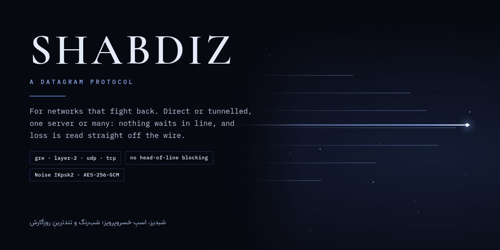
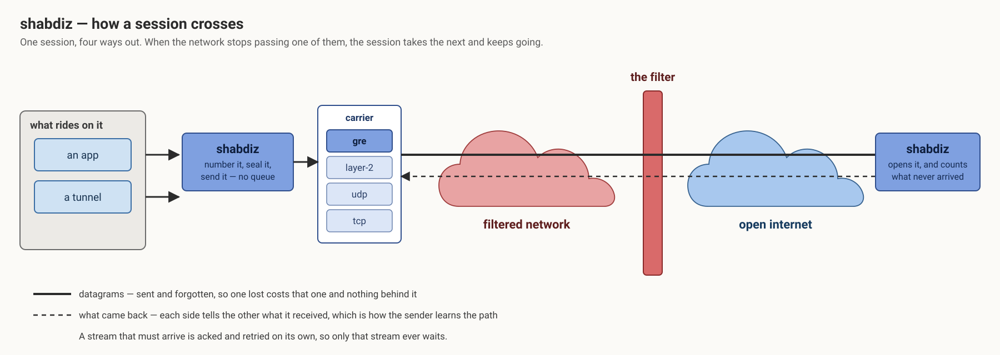
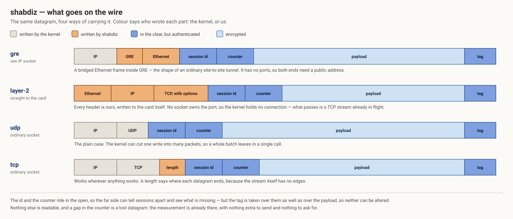

<p align="center">
  
</p>

<p align="center">
  <a href="README.md">English</a> · <b>فارسی</b>
</p>

<div dir="rtl">

# شبدیز

یک پروتکلِ دیتاگرامی با Rust، برای شبکه‌هایی که مقاومت می‌کنند. دیتاگرام‌های نامطمئن را سرتاسری
می‌برد — و برای ترافیکی که لازم دارد، جریان‌های مطمئن — روی هر حاملی که شبکه هنوز عبور می‌دهد.
هم می‌شود مستقیم بین دو برنامه به کار بردش، هم به‌عنوان چیزی که یک تونل روی آن سوار می‌شود.

## یک نشست چطور عبور می‌کند

</div>

<p align="center">
  
</p>

<div dir="rtl">

## چه چیزی روی سیم می‌رود

</div>

<p align="center">
  
</p>

<div dir="rtl">

## چیست

**هیچ‌چیز در صف نمی‌ماند.** یک دیتاگرام فرستاده می‌شود و فراموش. آن‌که گم شود فقط خودش را هزینه
می‌کند، نه چیزهایی که پشتش هستند — و دلیلِ کلِ ماجرا همین است: یک انتقالِ مطمئن و مرتب، چیزِ
اشتباهی است برای حملِ ترافیکی که خودش از قبل مطمئن و مرتب است.

**اطمینان، فقط جایی که خواسته شده.** جریانی که باید برسد، تأییدیه‌ها و بازارسال‌ها و پنجره‌ی
خودش را دارد. فقط همان جریان منتظر می‌ماند.

**چهار حامل پشتِ یک رابط.** GRE، فریم‌های لایه‌۲ که مستقیم روی کارتِ شبکه نوشته می‌شوند، UDP و
TCP. هر چیزی بالاتر از حامل یکسان است، پس مسیری که یکی را دیگر عبور ندهد یعنی تغییرِ یک خط
کانفیگ، نه بازنویسی.

**افت اندازه‌گیری می‌شود، نه تخمین زده.** هر دیتاگرام یک شمارنده دارد. شکاف در شمارنده یعنی
دیتاگرامِ گم‌شده، پس هر طرف بدونِ هیچ کاوش و تایمر و بایتِ اضافه می‌فهمد مسیر با او چه می‌کند — و
به طرفِ دیگر می‌گوید، چون فقط گیرنده می‌تواند ببیند یک جهت چه از دست می‌دهد.

**شکل‌دهی، نه خفه‌کردن.** پروتکل هرگز تصمیم نمی‌گیرد چقدر بفرستد: چیزی که رویش سوار است خودش
کنترلِ ازدحام دارد، و دوتایشان با هم می‌جنگند. آن‌چه تصمیم می‌گیرد **شکلِ** چیزی است که بیرون
می‌رود، چون بعضی مسیرها به انفجار بیشتر از نرخ حساس‌اند.

**احراز و رمزنگاری.** دست‌دادنِ Noise IKpsk2 با کلیدهای ثابتِ پین‌شده و یک کلیدِ از-پیش-مشترک، و
بعد AES-256-GCM روی هر دیتاگرام. شناسه‌ی نشست و شمارنده در وضوح می‌روند تا طرفِ مقابل بتواند
تفکیک و شمارش کند؛ برچسبِ احراز هم آن‌ها را می‌پوشاند هم محموله را.

## استفاده

</div>

```toml
[dependencies]
shabdiz = { git = "https://github.com/CluvexStudio/shabdiz" }
```

```rust
let carrier = Arc::new(shabdiz::carrier::udp::Udp::bind("0.0.0.0:7000", peer)?);
let accepted = shabdiz::handshake::accept(&*carrier, &local_key, &peer_key, &psk).await?;
let session = shabdiz::session::start(
    carrier,
    accepted.keys,
    accepted.params,
    shabdiz::session::Role::Responder,
    shabdiz::session::Config::default(),
    Some(shabdiz::session::Handshake { first: accepted.first, reply: accepted.reply }),
);

session.send(flow, b"a datagram");
let (flow, bytes) = session.recv().await?;
```

<div dir="rtl">

حامل‌های GRE و لایه‌۲ فریمِ خام می‌نویسند و به `CAP_NET_RAW` نیاز دارند؛ UDP و TCP به چیزی نیاز
ندارند. GRE پورت ندارد، پس برای دو میزبانی است که هر دو نشانیِ عمومی دارند.

## ساختار

</div>

```
src/wire.rs          انواع فریم، و این‌که یک دیتاگرام چطور چیده می‌شود
src/crypto.rs        مهر و باز کردن، و شمارنده‌ای که افت را می‌سنجد
src/handshake.rs     Noise IKpsk2، و آن‌چه دو سر بر سرش توافق می‌کنند
src/session.rs       مسیرِ داده: یک تسک می‌فرستد، یکی می‌گیرد
src/stream.rs        اطمینان، برای ترافیکی که می‌خواهدش
src/carrier/         gre · l2 · udp · tcp، پشتِ یک trait
```

<div dir="rtl">

## لایسنس

AGPL-3.0-only — فایل [LICENSE](LICENSE).

</div>
