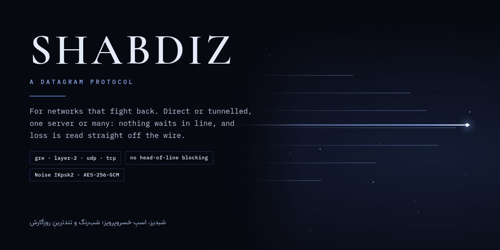
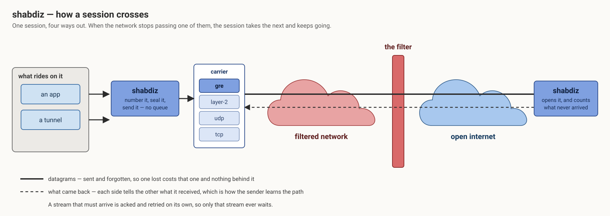
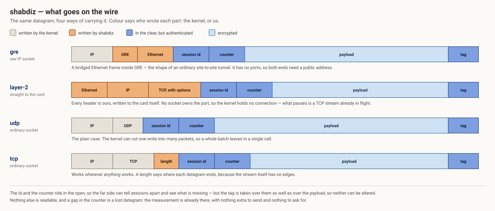

<p align="center">
  
</p>

<p align="center">
  <b>English</b> · <a href="README.fa.md">فارسی</a>
</p>

# shabdiz

A datagram protocol in Rust, for networks that fight back. It carries unreliable datagrams end to
end — and reliable streams for the traffic that needs them — over whichever carrier the network
still lets through. Use it directly between two programs, or as the thing a tunnel runs on.

## How a session crosses

<p align="center">
  
</p>

## What goes on the wire

<p align="center">
  
</p>

## What it is

**Nothing waits in line.** A datagram is sent and forgotten. One that goes missing costs that
datagram and nothing behind it — which is the whole reason a reliable, ordered transport is the
wrong thing to carry traffic that is already reliable and ordered.

**Reliability where it is asked for, and nowhere else.** A stream that must arrive gets its own
acknowledgements, its own retransmits and its own window. Only that stream ever waits.

**Four carriers behind one interface.** GRE, layer-2 frames written straight to the card, UDP and
TCP. Everything above the carrier is identical whichever is in use, so a path that stops carrying
one of them is a config change rather than a rewrite.

**Loss measured, not estimated.** Every datagram carries a counter. A gap in it is a lost
datagram, so each side learns what the path is doing to it without a probe, a timer or an extra
byte — and tells the other, because only a receiver can see what a direction loses.

**Shaped, not throttled.** The protocol never decides how much to send: whatever rides on it
already has a congestion controller, and two of them fight. What it does decide is the shape of
what leaves, because some paths object to a burst more than to a rate.

**Authenticated and encrypted.** A Noise IKpsk2 handshake with pinned static keys and a
pre-shared key, then AES-256-GCM on every datagram. The session id and the counter travel in the
open so the far side can sort and count; the tag covers them as well as the payload.

## Using it

```toml
[dependencies]
shabdiz = { git = "https://github.com/CluvexStudio/shabdiz" }
```

```rust
let carrier = Arc::new(shabdiz::carrier::udp::Udp::bind("0.0.0.0:7000".parse()?).await?);
let accepted = shabdiz::handshake::accept(&*carrier, &local_key, &peer_key, &psk).await?;
let session = shabdiz::session::start(
    carrier,
    accepted.keys,
    accepted.params,
    shabdiz::session::Role::Responder,
    shabdiz::session::Config::default(),
    Some(shabdiz::session::Handshake { first: accepted.first, reply: accepted.reply }),
);

session.send(flow, b"a datagram");
let (flow, bytes) = session.recv().await?;
```

The GRE and layer-2 carriers write raw frames, so they need `CAP_NET_RAW`; UDP and TCP need
nothing. GRE has no ports, so it is for two hosts that both have a public address.

## Shape

```
src/wire.rs          the frame types, and how a datagram is laid out
src/crypto.rs        sealing, opening, and the counter that measures loss
src/handshake.rs     Noise IKpsk2, and what the two ends agree on
src/session.rs       the datapath: one task sending, one receiving
src/stream.rs        reliability, for the traffic that asks for it
src/carrier/         gre · l2 · udp · tcp, behind one trait
```

## License

AGPL-3.0-only. See [LICENSE](LICENSE).
